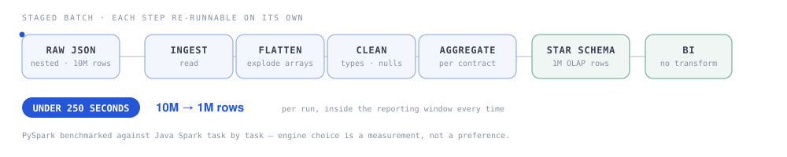

# Big-Data Batch Processing — 10M rows in under 250 seconds


[](https://github.com/nhmTri/FPT_processing_bigdata/actions/workflows/checks.yml)




A staged Spark batch pipeline that turns **10 million raw JSON log records into 1 million OLAP-ready rows in under 250 seconds per run** — inside the reporting window, every run.

> Built during a data engineering project with FPT-style telecom viewing logs. Data used here is sample/synthetic; no client data is committed.

**[▶ Demo video](https://drive.google.com/file/d/1CPp5jQS-OPERCuMbpCZSnlkHCB0UMFH3/view?usp=sharing)**

---

## The problem

Raw viewing logs arrive as deeply nested JSON, one file per day, tens of millions of rows per batch. Reporting needs one row per contract with behaviour summarised across content categories — and it needs it before the reporting window closes.

## The pipeline

Each stage is a separate, re-runnable step. A failure in aggregation does not force a re-read of the raw layer.

## The decision worth writing down

I ran **PySpark against Java Spark task by task** rather than picking an engine by preference, and kept whichever held throughput as volume grew.

**Engine choice is a measurement, not a preference.** The benchmark is in `Result_Method1/`.

## Output schema

| Column | Meaning |
|---|---|
| `Contract` | Customer contract ID |
| `Activeness` | Number of active days in the period |
| `Giai Tri` / `Phim Truyen` / `The Thao` / `Thieu Nhi` / `Truyen Hinh` | Watch duration per content category |
| `MostWatch` | Category with the highest duration |
| `Taste` | Concatenated behaviour profile across categories |

## Run it

```bash
git clone https://github.com/nhmTri/FPT_processing_bigdata.git
cd FPT_processing_bigdata
pip install -r python/requirements.txt
spark-submit python/OLAP_OUTPUT.py --input data/sample/ --output output/
```

Java version:

```bash
cd java && mvn clean package
spark-submit --class com.nhmtri.BatchJob target/*.jar
```

## Repo map

```
python/              PySpark implementation + requirements.txt
java/                Java Spark implementation (same stages, for benchmarking)
Result_Method1/      Benchmark write-up + a 200-row synthetic sample of the output
data/sample/         200 synthetic input records so the pipeline runs out of the box
output/              Generated at run time — not tracked
```

All data in this repository is **generated**. Contract identifiers and device addresses in the sample files are synthetic; no real customer records are committed.

## What I took from it

Spark at scale, and the habit of proving a tooling decision with a benchmark instead of an opinion.

---

**Stack** · PySpark · Java Spark · nested JSON · star schema
**More** · [portfolio case study](https://portfolionhmtri.netlify.app)

---

## What CI checks, and why that check exists

Every push runs three jobs. Two of them are ordinary — the Java Spark job compiles,
the Python sources compile. The third is the one worth reading.

`tests/test_data_contract.py` asserts that nothing under `data/` could be real:

| Check | Fails when |
|---|---|
| Identifiers are marked synthetic | any record's `_id` is missing the `SYN` prefix |
| No contact details | a parsed string value is shaped like an email address or a phone number |
| Committed data stays sample-sized | a file under `data/` exceeds 5 MB or 50,000 rows |

That last row is the one that matters. A sample repository has no business holding a
production extract, and the difference between a sample and an extract is a number a
reviewer will never check by hand. So the cap is enforced on every push: an oversized
file fails the build rather than quietly becoming public.

The sample is checked for shape as well — the schema the Spark job reads, the types
the transforms assume, and whether every `AppName` value is one the categoriser
actually maps. An unmapped value would otherwise fall through silently and quietly
mis-bucket a whole content type.

```bash
pip install -r python/requirements.txt
pytest tests/ -q
```
